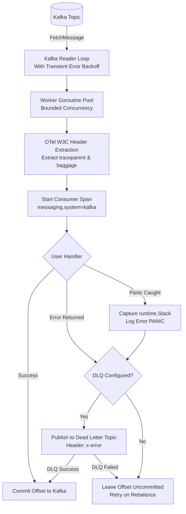

# Kafka Messaging SDK (`gosdk/messaging/kafka`)

The `github.com/agilsyofian/gosdk/messaging/kafka` module is an enterprise-grade Apache Kafka client transport engineered for banking/fintech microservices, event-driven architectures, and high-throughput cloud-native Kubernetes workloads. Built on pure Go (`github.com/segmentio/kafka-go`, no CGO dependencies), it provides resilient worker goroutines, OpenTelemetry Semantic Messaging Spans, automated Dead Letter Queue (DLQ) poison-pill routing, multi-cluster migration primitives, and ergonomic SASL authentication.

---

## 🚀 Key Capabilities & Features

- 🛡️ **Worker Resilience & Panic Safety**:
  - **Handler Panic Recovery**: Recovers from panics inside user handler functions, logs the full `runtime.Stack` at `Error` level (`PANIC`), and avoids pod crashes.
  - **Automatic DLQ Forwarding**: When a panic or error occurs and a Dead Letter Queue is configured (`WithDeadLetterTopic`), the poison message is automatically forwarded to the DLQ topic with the failure reason in `x-error: panic: ...`.
  - **Offset Commit on DLQ Delivery**: Upon successful forwarding to DLQ, the consumer commits the message offset to prevent permanent poison-pill loops that block partitions.
  - **Transient Network Error Backoff**: Handles broker hiccups, leader rebalances, and network blips with exponential backoff (`WithFetchBackoff`) and failure thresholds (`WithMaxConsecutiveErrors`).
- 🔍 **OpenTelemetry Semantic Messaging Spans**:
  - **Producer Spans (`trace.SpanKindProducer`)**: Instruments `Publish` calls with standard semantic conventions: `messaging.system = "kafka"`, `messaging.destination.name = topic`, and `messaging.operation = "publish"`.
  - **Consumer Spans (`trace.SpanKindConsumer`)**: Wraps message processing with `messaging.operation = "process"`, `messaging.kafka.message.offset`, and `messaging.kafka.message.partition`.
  - **W3C TraceContext Propagation**: Automatically injects and extracts W3C `traceparent` and baggage headers across message boundaries using `go.opentelemetry.io/otel/propagation`.
- 🔐 **Payload Logging & Sensitive Data Masking**:
  - Optional debug logging for payloads via `WithProducerLogPayload(true)` and `WithConsumerLogPayload(true)` (disabled by default for performance and privacy).
  - Integrates seamlessly with `core/observability/logger` to automatically mask sensitive fields (passwords, PINs, OTPs, CVVs, tokens, NIK) in JSON payloads.
- 🔄 **Multi-Cluster Zero-Downtime Migration Support**:
  - **`DualConsumer`**: Runs concurrent consumers across two separate Kafka clusters (e.g. On-Premises & Cloud / Old & New) with a single unified business handler and synchronized graceful termination.
  - **`MigrationProducer`**: Thread-safe producer capable of dynamic cluster cutover (`UseSecondary(bool)`) and **Shadow Writing** (`SetDualPublish(bool)`) for smoke testing new clusters prior to cutover.
- 🔑 **Ergonomic SASL Authentication**:
  - Native functional options without needing external SASL packages: `WithSASLPlain`, `WithSASLScramSHA256`, and `WithSASLScramSHA512`.
  - Safe for optional environment variables: empty credentials act as a no-op, while partial credentials fail fast during startup.
- ⚡ **Concurrent Worker Pool**:
  - Configurable goroutine worker concurrency per consumer group topic (`WithConcurrency(n)`).

---

## 🏛️ Architecture & Processing Lifecycle

### Consumer Processing Pipeline with DLQ



### Multi-Cluster Migration (Dual Consumer & Migration Producer)

```mermaid
flowchart LR
    subgraph Old Cluster [Old Kafka Cluster]
        OldTopic[(Topic)]
    end

    subgraph New Cluster [New Kafka Cluster]
        NewTopic[(Topic)]
    end

    subgraph Consumer Migration
        OldTopic --> C1[Primary Consumer]
        NewTopic --> C2[Secondary Consumer]
        C1 & C2 --> DualConsumer[DualConsumer Wrapper]
        DualConsumer --> BusinessHandler[Unified Business Handler]
    end

    subgraph Producer Migration
        App[Application Service] --> MigProducer[MigrationProducer]
        MigProducer -->|Active Route| OldTopic
        MigProducer -.->|Shadow Write (DualPublish)| NewTopic
    end
```

---

## ⚙️ Functional Options Reference

### Client Options (`New(brokers, opts...)`)

| Option | Type | Description |
| :--- | :--- | :--- |
| `WithLogger(l logger.Logger)` | `logger.Logger` | Sets the structured logger instance. |
| `WithAppName(name string)` | `string` | Sets the application identifier injected into traces and logs. |
| `WithSASLPlain(user, pass)` | `string, string` | Configures SASL/PLAIN authentication mechanism. |
| `WithSASLScramSHA256(user, pass)` | `string, string` | Configures SASL/SCRAM-SHA-256 authentication mechanism. |
| `WithSASLScramSHA512(user, pass)` | `string, string` | Configures SASL/SCRAM-SHA-512 authentication mechanism. |
| `WithTLS(cfg *tls.Config)` | `*tls.Config` | Configures TLS encryption for Kafka broker connections. |

### Producer Options (`client.Producer(topic, opts...)`)

| Option | Type | Default | Description |
| :--- | :--- | :--- | :--- |
| `WithProducerLogPayload(enable)` | `bool` | `false` | Enables logging message payload bytes (masked for sensitive data). |

### Consumer Options (`client.Consumer(topic, groupID, opts...)`)

| Option | Type | Default | Description |
| :--- | :--- | :--- | :--- |
| `WithConcurrency(n)` | `int` | `1` | Number of concurrent message processing worker goroutines. |
| `WithDeadLetterTopic(topic)` | `string` | `""` | Dead letter topic for failed or panic-inducing messages. |
| `WithMaxConsecutiveErrors(n)` | `int` | `10` | Maximum consecutive fetch errors before consumer worker exits. |
| `WithFetchBackoff(init, max)` | `time.Duration` | `500ms, 5s` | Initial and maximum backoff duration for transient read errors. |
| `WithConsumerLogPayload(enable)` | `bool` | `false` | Enables logging message payload bytes (masked for sensitive data). |

---

## 💻 Code Examples

### 1. Initializing Client & Producer

```go
package main

import (
	"context"
	"log"

	"github.com/agilsyofian/gosdk/core/observability/logger"
	"github.com/agilsyofian/gosdk/messaging/kafka"
)

func main() {
	ctx := context.Background()

	// Initialize Kafka client with SCRAM-SHA-512 authentication
	client, err := kafka.New(
		[]string{"kafka-1:9092", "kafka-2:9092"},
		kafka.WithAppName("order-service"),
		kafka.WithSASLScramSHA512("my-user", "my-secret-password"),
	)
	if err != nil {
		log.Fatalf("failed to create kafka client: %v", err)
	}
	defer client.Close()

	// Create a producer for the "orders" topic
	producer, err := client.Producer("orders", kafka.WithProducerLogPayload(true))
	if err != nil {
		log.Fatalf("failed to create producer: %v", err)
	}

	// Publish a message with trace context
	msg := &kafka.Message{
		Key:     []byte("ORDER-12345"),
		Payload: []byte(`{"order_id":"12345","amount":150000}`),
		Headers: map[string]string{
			"x-source": "checkout-api",
		},
	}

	if err := producer.Publish(ctx, msg); err != nil {
		log.Printf("publish failed: %v", err)
	}
}
```

---

### 2. Resilient Consumer with DLQ & Concurrency

```go
package main

import (
	"context"
	"fmt"
	"log"
	"os"
	"os/signal"
	"syscall"
	"time"

	"github.com/agilsyofian/gosdk/messaging/kafka"
)

func main() {
	client, err := kafka.New([]string{"localhost:9092"}, kafka.WithAppName("payment-worker"))
	if err != nil {
		log.Fatal(err)
	}
	defer client.Close()

	// Create consumer with 5 concurrent workers and DLQ for poison pill safety
	consumer, err := client.Consumer(
		"orders",
		"payment-processor-group",
		kafka.WithConcurrency(5),
		kafka.WithDeadLetterTopic("orders.DLQ"),
		kafka.WithMaxConsecutiveErrors(15),
		kafka.WithFetchBackoff(500*time.Millisecond, 5*time.Second),
	)
	if err != nil {
		log.Fatal(err)
	}

	ctx, cancel := signal.NotifyContext(context.Background(), os.Interrupt, syscall.SIGTERM)
	defer cancel()

	// Start consuming messages
	err = consumer.Consume(ctx, func(hCtx context.Context, msg *kafka.Message) error {
		// Panic safety: even if a panic occurs here, it is caught, logged with stack trace,
		// routed to "orders.DLQ", and the offset is committed so the partition keeps moving!
		if string(msg.Key) == "POISON-PILL" {
			panic("unexpected nil pointer encountered")
		}

		fmt.Printf("Processing order %s: %s\n", string(msg.Key), string(msg.Payload))
		return nil
	})

	if err != nil && err != context.Canceled {
		log.Printf("consumer exited with error: %v", err)
	}
}
```

---

### 3. Multi-Cluster Migration (Dual Consumer)

Consuming messages from both Old and New Kafka clusters simultaneously during migration:

```go
// Initialize clients for both clusters
primaryClient, _ := kafka.New([]string{"old-broker:9092"})
secondaryClient, _ := kafka.New([]string{"new-broker:9092"})

cOld, _ := primaryClient.Consumer("transactions", "tx-group")
cNew, _ := secondaryClient.Consumer("transactions", "tx-group")

// Wrap into DualConsumer
dualConsumer, err := kafka.NewDualConsumer(cOld, cNew)
if err != nil {
    log.Fatal(err)
}
defer dualConsumer.Close()

// Single handler receives events from BOTH clusters seamlessly
err = dualConsumer.Consume(ctx, func(ctx context.Context, msg *kafka.Message) error {
    return processTransaction(ctx, msg)
})
```

---

### 4. Dynamic Switch & Shadow Writing (Migration Producer)

```go
pPrimary, _ := primaryClient.Producer("events")
pSecondary, _ := secondaryClient.Producer("events")

migProducer, err := kafka.NewMigrationProducer(pPrimary, pSecondary)
if err != nil {
    log.Fatal(err)
}
defer migProducer.Close()

// 1. Shadow Writing mode: writes to Primary, duplicates writes to Secondary asynchronously
migProducer.SetDualPublish(true)
migProducer.Publish(ctx, msg)

// 2. Dynamic Cutover: switch active route to Secondary cluster with zero downtime
migProducer.UseSecondary(true)
migProducer.SetDualPublish(false) // Disable shadow write after cutover
migProducer.Publish(ctx, msg)
```

---

## 🔒 Security Best Practices

1. **Keep Secrets Out of Code**: Inject SASL credentials via environment variables (`KAFKA_USERNAME`, `KAFKA_PASSWORD`) and pass them to `WithSASLScramSHA512(user, pass)`.
2. **Payload Logging in Production**: Keep `WithProducerLogPayload` and `WithConsumerLogPayload` set to `false` in production environments unless performing specific debug troubleshooting. Even when enabled, sensitive fields are filtered automatically.
3. **Always Configure DLQs for Critical Queues**: Without a DLQ, a permanently failing message (e.g. malformed data that fails validation every time) will block its Kafka partition indefinitely.
