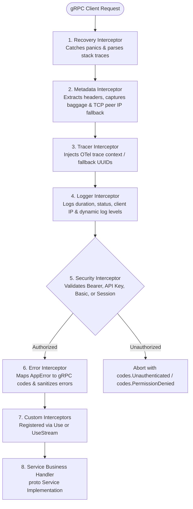

# gRPC Server Transport (`gosdk/transport/server/grpc`)

The `github.com/agilsyofian/gosdk/transport/server/grpc` module is an enterprise-grade gRPC server transport engineered for banking/fintech-grade reliability, high-throughput microservice communication, and cloud-native Kubernetes environments. It provides full Unary and Streaming RPC parity, robust panic recovery with stack trace analysis, real TCP peer IP extraction, OpenTelemetry distributed tracing, standard `grpc.health.v1` health checking, declarative security auto-wiring, and distributed idempotency.

---

## 🚀 Key Capabilities & Features

- 🛡️ **Critical Reliability & Resilient Lifecycle**:
  - **Force-Stop Graceful Shutdown Fallback**: Runs `GracefulStop()` in a background worker with bounded timeout fallback (`shutdown_timeout`, default `30s`) that calls `Stop()` to force-close connections if streams or handlers hang, preventing infinite shutdown stalls.
  - **Structured Panic Recovery**: Intercepts panics across Unary and Streaming RPCs, parses `runtime/debug.Stack()`, isolates source code locations (`File`, `Func`, `Line`), logs full diagnostic traces via structured logger, and converts panics into standard gRPC `Internal` status errors.
  - **Service Registration Rebuild Protection**: Any services registered via `RegisterService` or proto registrars persist across dynamic interceptor (`Use`, `UseStream`) or option rebuilds.
- 🔁 **Full Streaming & Unary RPC Parity**:
  - Complete symmetry between Unary and Streaming pipelines: `RecoveryStream`, `MetadataStream`, `TracerStream`, `LoggerStream`, and `ErrorStream`.
  - Custom stream interceptors supported via `UseStream(...)`.
- 🔍 **Real Client IP & Trace Context Fallback**:
  - **TCP Peer IP Fallback**: Discovers client IPs via `peer.FromContext(ctx)` when metadata proxy headers (`x-forwarded-for`, `x-real-ip`) are missing on internal service meshes.
  - **Trace ID / Span ID Fallback Generation**: Automatically generates fallback UUIDs and propagates them through context and outgoing metadata even if the tracer exporter is disabled or unconfigured.
- 📊 **Dynamic Logging & Sensitive Data Protection**:
  - Automatically records Duration, Path, Request/Response payloads, gRPC Status Codes, and Client IPs.
  - Dynamic log level routing: `Info` for successful calls (`codes.OK`), `Warn` for client errors (`codes.InvalidArgument`, `codes.NotFound`, etc.), and `Error` for server faults (`codes.Internal`, `codes.Unavailable`).
  - Automatic JSON protobuf payload deserialization and masking for sensitive fields (`password`, `pin`, `otp`, `token`, `authorization`) via centralized `core/observability/logger`.
- ☸️ **Kubernetes Standard Health Checking (`grpc.health.v1`)**:
  - Built-in standard `google.golang.org/grpc/health` protocol supporting Kubernetes `grpc-health-probe`.
  - Automatically reports `SERVING` upon server boot and immediately transitions to `NOT_SERVING` upon initiation of `Shutdown(ctx)` to divert Ingress/Mesh traffic.
  - Bridges with transport-agnostic `core/observability/health.Registry`.
- 🔐 **Declarative Security Configuration**:
  - Declarative configuration in `env.yaml` under `server.grpc.security`.
  - `SetSecurityManager(mgr, cfgs...)` auto-wires both Unary and Streaming security interceptors.
- ⚡ **Production Keepalive & Flow Control**:
  - Comprehensive keepalive tuning: connection idle, max age, ping intervals, and enforcement policies.

---

## 🏛️ Interceptor Execution Pipeline

Every incoming Unary and Streaming RPC passes through a structured, layered interceptor pipeline:



---

## ⚙️ Configuration Guide (`env.yaml`)

Configure the gRPC server declaratively through YAML:

```yaml
server:
  grpc:
    # Server Address & Port
    addr: ":8081"

    # gRPC Reflection (grpcurl, Postman support)
    reflection_enabled: true

    # Error Formatting: set to true in dev/staging to include internal causes
    show_error_detail: true

    # Graceful shutdown deadline before forced connection termination
    shutdown_timeout: "30s"

    # Concurrency & Buffer Limits
    max_concurrent_streams: 1000
    max_receive_message_size: 16777216 # 16MB
    max_send_message_size: 16777216    # 16MB
    connection_timeout: "120s"

    # Standard Kubernetes Health Protocol (grpc.health.v1)
    health_check_enabled: true

    # HTTP/2 & TCP Keepalive Tuning
    keepalive:
      max_connection_idle: "15s"
      max_connection_age: "30s"
      max_connection_age_grace: "5s"
      time: "10s"
      timeout: "3s"
      min_time: "5s"
      permit_without_stream: true

    # Declarative Request Metadata & Header Mapping
    metadata:
      trace_id_header: "X-Trace-Id"
      request_id_header: "X-Request-Id"
      session_id_header: "X-Session-Id"
      user_id_header: "X-User-Id"
      capture_headers:
        - "X-Device-Id"
        - "X-Tenant-Id"
        - "X-App-Version"

    # Declarative Security Configuration (Phase 6)
    security:
      required: true
      enable_bearer: true
      enable_basic: false
      enable_api_key: true
      api_key_metadata_key: "x-api-key"
      session_metadata_key: "x-session-id"
```

---

## 🛠️ Usage Guide

### 1. Server Initialization

Initialize in Pure Go without framework dependencies, or wire into Uber Fx at the application bootstrap level:

```go
package main

import (
    "context"
    "github.com/agilsyofian/gosdk/transport/server/grpc"
)

func main() {
    // Pure Go constructor — zero framework coupling
    server := grpc.NewServer("my-service", loggerInstance, configInstance, tracerInstance)

    // Register proto services
    user.RegisterServiceUserServer(server.Engine(), userHandler)

    // Start server in background
    go server.Start()

    // Graceful shutdown on termination signal
    defer server.Shutdown(context.Background())
}
```

#### Wiring with Uber Fx (at Application Bootstrap Level)
```go
package bootstrap

import (
    "context"
    "github.com/agilsyofian/gosdk/core/observability/logger"
    "github.com/agilsyofian/gosdk/core/observability/tracing"
    "github.com/agilsyofian/gosdk/transport/server/grpc"
    "go.uber.org/fx"
)

var Server = fx.Module("server",
    fx.Provide(
        func(cfg AppConfig) grpc.Config {
            return cfg.Server.GrpcServer
        },
        fx.Annotate(
            func(lc fx.Lifecycle, appName string, l logger.Logger, cfg grpc.Config, t *tracing.Tracing) *grpc.Server {
                s := grpc.NewServer(appName, l, cfg, t)
                lc.Append(fx.Hook{
                    OnStart: func(ctx context.Context) error {
                        go func() { _ = s.Start() }()
                        return nil
                    },
                    OnStop: func(ctx context.Context) error {
                        if t != nil {
                            _ = t.Shutdown(ctx)
                        }
                        return s.Shutdown(ctx)
                    },
                })
                return s
            },
            fx.ParamTags(`name:"appName"`),
        ),
    ),
)
```

---

### 2. Service Registration & Security Wiring

Wire services, health checks, and security in your gRPC module:

```go
package server

import (
    "github.com/agilsyofian/gosdk/core/observability/health"
    "github.com/agilsyofian/gosdk/example/proto/user"
    "github.com/agilsyofian/gosdk/security"
    "github.com/agilsyofian/gosdk/transport/server/grpc"
    "go.uber.org/fx"
)

type GrpcHandlerDeps struct {
    fx.In

    Server      *grpc.Server
    Health      health.Registry
    Security    security.SecurityManager
    UserHandler user.ServiceUserServer
}

func NewGrpcHandler(deps GrpcHandlerDeps) *GrpcHandler {
    // 1. Wire transport-agnostic health checks into standard grpc.health.v1
    if deps.Health != nil {
        deps.Server.SetHealthRegistry(deps.Health)
    }

    // 2. Auto-wire security manager using declarative config from env.yaml
    if deps.Security != nil {
        deps.Server.SetSecurityManager(deps.Security)
    }

    // 3. Register proto service implementations
    user.RegisterServiceUserServer(deps.Server, deps.UserHandler)

    return &GrpcHandler{server: deps.Server}
}
```

---

### 3. Handling Stream RPCs & Custom Interceptors

Attach custom Unary and Stream interceptors using `Use` and `UseStream`:

```go
// Custom Unary Interceptor
server.Use(func(ctx context.Context, req any, info *grpc.UnaryServerInfo, handler grpc.UnaryHandler) (any, error) {
    // Before handler
    resp, err := handler(ctx, req)
    // After handler
    return resp, err
})

// Custom Stream Interceptor
server.UseStream(func(srv any, ss grpc.ServerStream, info *grpc.StreamServerInfo, handler grpc.StreamHandler) error {
    // Stream lifecycle tracking
    return handler(srv, ss)
})
```

---

### 4. Distributed Idempotency (gRPC Interceptor)

Prevent duplicate processing of critical state-changing gRPC calls:

```go
import (
    "github.com/agilsyofian/gosdk/storage/cache"
    "github.com/agilsyofian/gosdk/transport/server/grpc/interceptor"
)

// Attach idempotency interceptor to gRPC server
server.Use(interceptor.Idempotency(cacheClient,
    interceptor.WithIdempotencyMetadataKey("x-idempotency-key"),
    interceptor.WithIdempotencyTTL(2 * time.Minute),
    interceptor.WithIdempotencyIgnoreMethods("/grpc.health.v1.Health/Check"),
))
```

---

### 5. Accessing Authenticated Security Context

Retrieve the caller's identity inside your gRPC service implementation:

```go
package service

import (
    "context"
    "github.com/agilsyofian/gosdk/security"
    "github.com/agilsyofian/gosdk/example/proto/user"
)

func (s *UserHandler) GetUser(ctx context.Context, req *user.Request) (*user.Response, error) {
    // Retrieve authenticated principal from context
    secCtx, ok := security.FromContext(ctx)
    if ok && secCtx.Principal != nil {
        s.logger.Info(ctx, "authenticated caller", logger.LogPayload{
            TraceId: secCtx.Principal.Subject,
        })
    }

    return &user.Response{UserId: req.Username, Status: "ACTIVE"}, nil
}
```

---

## 🩺 Kubernetes Readiness & Health Checking

The server implements the official **[gRPC Health Checking Protocol](https://github.com/grpc/grpc/blob/master/doc/health-checking.md)** (`grpc.health.v1`).

### Kubernetes Deployment Configuration (`grpc-health-probe`)

```yaml
livenessProbe:
  grpc:
    port: 8081
    service: ""
  initialDelaySeconds: 5
  periodSeconds: 10

readinessProbe:
  grpc:
    port: 8081
    service: "example-app"
  initialDelaySeconds: 3
  periodSeconds: 5
```

### Lifecycle Serving States
- **Startup**: Transitions to `HealthCheckResponse_SERVING` for both the default service (`""`) and the application name (`appName`).
- **Shutdown**: Immediately transitions to `HealthCheckResponse_NOT_SERVING` upon initiation of `Shutdown(ctx)`, signaling Kubernetes load balancers and Ingress to stop routing traffic before connections drain.

---

## 🚦 Error Handling & gRPC Status Code Mapping

The `Error` and `ErrorStream` interceptors automatically convert application errors (`core/errors.AppError`) to standard gRPC status codes:

| SDK Error / HTTP Equivalent | gRPC Status Code | Description |
| :--- | :--- | :--- |
| `errors.BadRequest` (400) | `codes.InvalidArgument` (3) | Invalid request payload or parameters |
| `errors.Unauthorized` (401) | `codes.Unauthenticated` (16) | Missing or expired credentials |
| `errors.Forbidden` (403) | `codes.PermissionDenied` (7) | Caller lacks required permissions |
| `errors.NotFound` (404) | `codes.NotFound` (5) | Requested resource does not exist |
| `errors.Conflict` (409) | `codes.AlreadyExists` (6) | Resource collision or conflict |
| `errors.TooManyRequests` (429) | `codes.ResourceExhausted` (8) | Rate limit or quota exceeded |
| `errors.Timeout` (504) | `codes.DeadlineExceeded` (4) | Operation deadline expired |
| Native `status.Status` | *Preserved* | Any native gRPC status returned directly is preserved |
| Unhandled errors / Panics | `codes.Internal` (13) | Sanitized as `"Internal server error"` (details hidden unless `show_error_detail: true`) |

---

## 🧪 Testing & Verification

Run the comprehensive unit test suite:

```bash
# Test gRPC server, interceptors, and security adapter
go test -v -count=1 ./SDK/transport/server/grpc/...

# Test reference example integration
go test -v -count=1 ./SDK/examples/server/...
```
